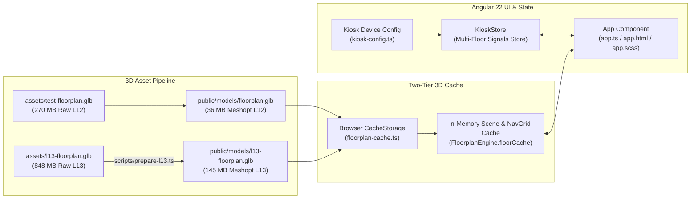

# SpaceBoard PC — Interactive 3D Workspace Booking & Multi-Floor Wayfinding Guide

This document covers the feature specifications, multi-kiosk URL configuration (`?kioskId=`), two-tier 3D floor plan caching architecture, multi-floor wayfinding engine, availability status color palette, reservation lifecycle rules, and maintainer workflows for **SpaceBoard PC**.

---

## 1. Product Overview & Feature Specifications

**SpaceBoard PC** is an interactive 3D workspace reservation and multi-floor indoor wayfinding application built with **Angular 22** and **Three.js (r187)**. It supports multiple floor plans (**Level 12** and **Level 13**), configurable starting kiosk positions via URL query parameters (`?kioskId=l12-1`, `?kioskId=l13-1`, `?kioskId=l13-2`), two-tier 3D model caching, live room/desk availability coloring, and seamless single-floor and cross-floor navigation via paired lift shafts.

### 1.1 Multi-Kiosk Device Configuration (`?kioskId=`)

Multiple physical kiosk machines (or desktop browser instances) can load the same application URL while passing their device identifier in the query string. The configuration lives in [src/app/wayfinding/kiosk-config.ts](file:///Volumes/LaCie/learn/3DKiosk/src/app/wayfinding/kiosk-config.ts):

| Kiosk Device ID (`?kioskId=`) | Scene Resource ID | Default Floor Plan | Accepted Query Aliases |
| :--- | :--- | :--- | :--- |
| `l12-1` *(Default Fallback)* | `WAYFINDING_KIOSK_L12_1` | **Level 12** (`models/floorplan.glb`) | `l12-1`, `l12_1`, `12-1`, `WAYFINDING_KIOSK_L12_1` |
| `l13-1` | `WAYFINDING_KIOSK_L13_1` | **Level 13** (`models/l13-floorplan.glb`) | `l13-1`, `l13_1`, `13-1`, `WAYFINDING_KIOSK_L13_1` |
| `l13-2` | `WAYFINDING_KIOSK_L13_2` | **Level 13** (`models/l13-floorplan.glb`) | `l13-2`, `l13_2`, `13-2`, `WAYFINDING_KIOSK_L13_2` |

* **Default Fallback**: If `?kioskId=` is omitted or does not match any configured kiosk device, `resolveKioskDeviceFromUrl()` falls back to `DEFAULT_KIOSK_DEVICE_ID` (`'l12-1'`) defined in [kiosk-config.ts](file:///Volumes/LaCie/learn/3DKiosk/src/app/wayfinding/kiosk-config.ts#L76).
* **Live Switcher**: Users or administrators can also switch the active kiosk device directly from the top header bar dropdown, which updates the browser URL (`?kioskId=...`) and moves the pulsing *"You are here"* beacon and default floor plan immediately.

### 1.2 Supported Resources Across Level 12 & Level 13

All clickable resources are enriched with metadata from [public/data/spaceboard-data.json](file:///Volumes/LaCie/learn/3DKiosk/public/data/spaceboard-data.json). Any furniture without a unique resource ID is treated strictly as a non-clickable decoration and pathfinding obstacle.

| Floor | GLB Node ID | Display Name | Code | Resource Type | Capacity | Equipment | Bookable |
| :--- | :--- | :--- | :--- | :--- | :--- | :--- | :--- |
| **Level 12** | `MeetingRoom_12_1` | **Orion** | `MR 12.1` | `Meeting Room` | 8 people | TV, Whiteboard, Video Conferencing, HDMI Wireless Cast | Yes |
| **Level 12** | `MeetingRoom_12_2` | **Apollo** | `MR 12.2` | `Focus Room` | 4 people | Whiteboard, Soundproofing, Speakerphone | Yes |
| **Level 12** | `MeetingRoom_12_3` | **Cedar** | `MR 12.3` | `Private Room` | 4 people | TV, Video Conferencing, Soundproofing | Yes |
| **Level 12** | `MeetingRoom_12_4` | **Nova** | `MR 12.4` | `Meeting Room` | 6 people | TV, Whiteboard, Video Conferencing | Yes |
| **Level 12** | `MeetingRoom_12_5` | **Atlas** | `MR 12.5` | `Meeting Room` | 12 people | TV, Whiteboard, Video Conferencing, Speakerphone, HDMI Wireless Cast | Yes |
| **Level 12** | `MeetingRoom_12_6` | **Vega** | `MR 12.6` | `Meeting Room` | 6 people | TV, Whiteboard, HDMI Wireless Cast | Yes |
| **Level 12** | `MeetingRoom_12_7` | **Luna** | `MR 12.7` | `Private Room` | 6 people | TV, Video Conferencing, Speakerphone, Soundproofing | Yes |
| **Level 12** | `MeetingRoom_12_8` | **Summit** | `MR 12.8` | `Focus Room` | 6 people | Whiteboard, TV, Soundproofing | Yes |
| **Level 12** | `Desk_12_001` – `003` | **Hot Desk 12-001** – **003** | `D 12-001`..`003` | `Desk` | 1 person | Dual Monitor, Standing Desk | Yes |
| **Level 12** | `WAYFINDING_LIFT_12_1` – `2` | **Lift 1 (L12)** – **Lift 2 (L12)** | `Lift 1`..`2` | `Lift` | — | Vertical transfer to Level 13 | No |
| **Level 12** | `WAYFINDING_KIOSK_L12_1` | **Kiosk L12-1** | `Kiosk 12-1` | `Kiosk` | — | Starting position (`?kioskId=l12-1`) | No |
| **Level 13** | `MeetingRoom_13_1` – `12` | **Meeting Room 13.1** – **13.12** | `MR 13.1`..`13.12` | `Meeting Room` | 4–12 people | TV, Whiteboard, Video Conferencing, Speakerphone | Yes |
| **Level 13** | `PrivateRoom_13_1` – `35` | **Private Room 13.1** – **13.35** | `PR 13.1`..`13.35` | `Private Room` | 3 people | TV, Soundproofing | Yes |
| **Level 13** | `FocusRoom_13_1` – `5` | **Focus Room 13.1** – **13.5** | `FR 13.1`..`13.5` | `Focus Room` | 2 people | Whiteboard, Soundproofing | Yes |
| **Level 13** | `Desk_13_001` | **Focus Desk 13-001** | `D 13-001` | `Desk` | 1 person | Dual Monitor, Standing Desk, Soundproofing | Yes |
| **Level 13** | `Desk_13_002` | **Focus Desk 13-002** | `D 13-002` | `Desk` | 1 person | Dual Monitor, Standing Desk, Soundproofing | Yes |
| **Level 13** | `Desk_13_003` | **Focus Desk 13-003** | `D 13-003` | `Desk` | 1 person | Standing Desk, Soundproofing | Yes |
| **Level 13** | `WAYFINDING_LIFT_13_1` – `2` | **Lift 1 (L13)** – **Lift 2 (L13)** | `Lift 1`..`2` | `Lift` | — | Vertical transfer to Level 12 | No |
| **Level 13** | `WAYFINDING_KIOSK_L13_1` | **Kiosk L13-1** | `Kiosk 13-1` | `Kiosk` | — | Starting position (`?kioskId=l13-1`) | No |
| **Level 13** | `WAYFINDING_KIOSK_L13_2` | **Kiosk L13-2** | `Kiosk 13-2` | `Kiosk` | — | Starting position (`?kioskId=l13-2`) | No |

### 1.3 Availability Status Colors & Reservation Lifecycle Rules

Bookable resources dynamically change their 3D floor plate color, 3D outline, emissive glow, and floating pill badge based on their reservation status during the user's selected **Date + Start/End Time** window:

| Status | Label | Hex Color | Lifecycle Rules (`status: 'starting' \| 'started'`) |
| :--- | :--- | :--- | :--- |
| **Available** | `Available` | `#4caf6a` (Green) | Free during the entire selected `[startTime, endTime]` window on the selected day. Users can create a new booking. |
| **Reserved** | `Reserve` | `#f0b429` (Amber / Yellow) | Has an upcoming reservation (`status: "starting"`). Users can **Update** all fields (Subject, Organizer, Date, Start/End Time), **Check In** to start it, or **Cancel** it. |
| **Occupied** | `Occupied` | `#d9534f` (Coral / Red) | Has an active reservation (`status: "started"`). Users can only **Edit Subject** (Organizer, Date, Start/End Time are locked) or **End** the reservation early. |

### 1.4 Multi-Floor Wayfinding

When a visitor navigates between two resources on different floors (for example, starting at `WAYFINDING_KIOSK_L13_1` on **Level 13** and navigating to **Orion (`MeetingRoom_12_1`)** on **Level 12**, or vice versa):
1. `Wayfinder.routeMultiFloor()` evaluates all paired lift shafts (`WAYFINDING_LIFT_12_1` $\leftrightarrow$ `WAYFINDING_LIFT_13_1` and `WAYFINDING_LIFT_12_2` $\leftrightarrow$ `WAYFINDING_LIFT_13_2`) and picks the lift transfer that minimizes total walking distance across both floors.
2. Produces a two-segment `Route` (`multiFloor: true`, `segments: [Leg 1, Leg 2]`):
   * **Leg 1 (Origin Floor)**: Walks from the origin resource to the optimal Lift on that floor, ending with a highlighted amber step: *"Take Lift 2 from Level 13 to Level 12"*.
   * **Leg 2 (Destination Floor)**: Starts with *"Exit Lift 2 on Level 12"* and guides the visitor to the final destination.
3. The Wayfinding sidebar displays **Leg 1 / Leg 2 Floor Switcher Pills** (`Leg 1: Level 13` / `Leg 2: Level 12`). Clicking a leg pill or any step in the turn-by-turn list immediately switches the 3D viewport to that floor and animates the camera to frame that floor's route ribbon.

### 1.5 Two-Tier 3D Floor Plan Caching

Because 3D floor plan GLB files are large (`36 MB` for Level 12 and `145 MB` for Level 13, down from `848 MB` raw), SpaceBoard PC implements a two-tier caching strategy in [src/app/three/floorplan-cache.ts](file:///Volumes/LaCie/learn/3DKiosk/src/app/three/floorplan-cache.ts) and [src/app/three/floorplan-engine.ts](file:///Volumes/LaCie/learn/3DKiosk/src/app/three/floorplan-engine.ts):
1. **Persistent Disk Cache (Browser Cache Storage API — `spaceboard-glb-cache-v1`)**:
   * The first time a floor plan GLB is fetched, its binary response is stored in the browser's persistent `CacheStorage`.
   * On subsequent page reloads, browser restarts, or `?kioskId=` URL changes, `fetchCachedGlbBuffer()` reads the binary buffer directly from local disk in `<150 ms` with zero network download.
2. **In-Memory Parsed Scene & NavGrid Cache (`FloorplanEngine.floorCache`)**:
   * Once a floor's GLTF scene, 3D overlays, `NavGrid`, and `Wayfinder` are built, they are kept in `this.floorCache: Map<string, CachedFloorScene>`.
   * Upon booting the default floor for the active kiosk device, `App.bootFloorPlans()` automatically preloads the remaining floor(s) in the background (`engine.preloadFloor(...)`), so switching between `L12` and `L13` or computing cross-floor routes is completely instantaneous.

---

## 2. System Architecture & Component Reference



### 2.1 Detailed Component Breakdown

1. **[src/app/wayfinding/kiosk-config.ts](file:///Volumes/LaCie/learn/3DKiosk/src/app/wayfinding/kiosk-config.ts)**
   * Defines `FLOOR_CONFIGS` (`Level 12` $\rightarrow$ `models/floorplan.glb`, `Level 13` $\rightarrow$ `models/l13-floorplan.glb`) and `KIOSK_DEVICES` (`l12-1`, `l13-1`, `l13-2`), plus `DEFAULT_KIOSK_DEVICE_ID = 'l12-1'`.
   * Provides `resolveKioskDeviceFromUrl()` to parse `?kioskId=` (case-insensitive) from the browser URL and fall back cleanly when not found.
2. **[src/app/three/floorplan-cache.ts](file:///Volumes/LaCie/learn/3DKiosk/src/app/three/floorplan-cache.ts)**
   * Implements `fetchCachedGlbBuffer(url, onProgress)` backed by `window.caches.open('spaceboard-glb-cache-v1')` with streaming download progress.
3. **[src/app/three/floorplan-engine.ts](file:///Volumes/LaCie/learn/3DKiosk/src/app/three/floorplan-engine.ts)**
   * Manages `floorCache: Map<string, CachedFloorScene>`, `loadFloor()`, `preloadFloor()`, `activateFloorScene()`, and multi-kiosk *"You are here"* beacons (`kioskBeacons`).
   * Renders the active floor segment of single-floor or multi-floor routes via `RouteVisual`.
4. **[src/app/wayfinding/wayfinder.ts](file:///Volumes/LaCie/learn/3DKiosk/src/app/wayfinding/wayfinder.ts)**
   * Computes single-floor routes (`route(fromId, toId)`) and cross-floor routes via paired lifts (`routeMultiFloor(fromId, toId, targetWayfinder, activeFloor)`).
5. **[src/app/kiosk.store.ts](file:///Volumes/LaCie/learn/3DKiosk/src/app/kiosk.store.ts)**
   * Aggregates resources and `Wayfinder` instances across all loaded floors, manages active `kioskId` device switching (`setKioskDevice`), active floor switching (`setFloor`), multi-criteria search/filtering across single or all floors (`searchAllFloors`), and reservation creation/updating/cancellation/ending.
6. **[scripts/prepare-l13.ts](file:///Volumes/LaCie/learn/3DKiosk/scripts/prepare-l13.ts)**
   * Preprocesses `assets/l13-floorplan.glb` (`848 MB` `obj2gltf` export in centimetres): converts coordinates to metres ($\times 0.01$), extracts and names `furniture_Desk_13_001`..`003`, `furniture_WAYFINDING_KIOSK_L13_1`..`2`, and `door_WAYFINDING_LIFT_13_1`..`2`, subdivides merged decorative furniture into localized $0.9\text{ m}\times 0.9\text{ m}$ obstacle clusters, adds a full perimeter floor slab for $100\%$ nav-grid coverage, and compresses geometry with `meshopt`.

---

## 3. Level 12 & Level 13 Navigation Grids

````carousel

<!-- slide -->

````

---

## 4. Build & Maintenance Commands

| Command | Description |
| :--- | :--- |
| `npm start` | Starts the development server at `http://localhost:4200` (try `?kioskId=l12-1`, `?kioskId=l13-1`, or `?kioskId=l13-2`). |
| `npm run build` | Builds the production bundle to `dist/kiosk3d`. |
| `npm run optimize-model` | Optimizes both `assets/test-floorplan.glb` (L12) and `assets/l13-floorplan.glb` (L13) into `public/models/`. |
| `npm run optimize-l13` | Runs `scripts/prepare-l13.ts` to rebuild `public/models/l13-floorplan.glb`. |
| `npx tsx scripts/nav-debug.ts /tmp/nav-l13.ppm public/models/l13-floorplan.glb WAYFINDING_KIOSK_L13_1` | Verifies Level 13 navigation grid and outputs a debug route image. |
