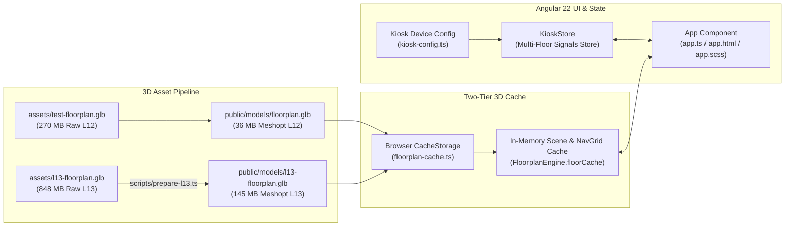

# SpaceBoard PC — Interactive 3D Workspace Booking & Multi-Floor Wayfinding Guide

This document covers the feature specifications, multi-kiosk URL configuration (`?kioskId=`), two-tier 3D floor plan caching architecture, multi-floor wayfinding engine, availability status color palette, reservation lifecycle rules, and maintainer workflows for **SpaceBoard PC**.

---

## 1. Product Overview & Feature Specifications

**SpaceBoard PC** is an interactive 3D workspace reservation and multi-floor indoor wayfinding application built with **Angular 22** and **Three.js (r187)**. It supports multiple floor plans (**Level 12** and **Level 13**), configurable starting kiosk positions via URL query parameters (`?kioskId=l12-1`, `?kioskId=l13-1`, `?kioskId=l13-2`), two-tier 3D model caching, live room/desk availability coloring, and seamless single-floor and cross-floor navigation via paired lift shafts.

### 1.1 Multi-Kiosk Device Configuration (`?kioskId=`)

Multiple physical kiosk machines (or desktop browser instances) can load the same application URL while passing their device identifier in the query string. The configuration lives in [src/app/wayfinding/kiosk-config.ts](file:///Volumes/LaCie/learn/3DKiosk/src/app/wayfinding/kiosk-config.ts):

| Kiosk Device ID (`?kioskId=`) | Scene Resource ID | Default Floor Plan | Accepted Query Aliases |
| :--- | :--- | :--- | :--- |
| `l12-1` *(Default Fallback)* | `WAYFINDING_KIOSK_L12_1` | **Level 12** (`models/floorplan.glb`) | `l12-1`, `l12_1`, `12-1`, `WAYFINDING_KIOSK_L12_1` |
| `l13-1` | `WAYFINDING_KIOSK_L13_1` | **Level 13** (`models/l13-floorplan.glb`) | `l13-1`, `l13_1`, `13-1`, `WAYFINDING_KIOSK_L13_1` |
| `l13-2` | `WAYFINDING_KIOSK_L13_2` | **Level 13** (`models/l13-floorplan.glb`) | `l13-2`, `l13_2`, `13-2`, `WAYFINDING_KIOSK_L13_2` |

* **Default Fallback**: If `?kioskId=` is omitted or does not match any configured kiosk device, `resolveKioskDeviceFromUrl()` falls back to `DEFAULT_KIOSK_DEVICE_ID` (`'l12-1'`) defined in [kiosk-config.ts](file:///Volumes/LaCie/learn/3DKiosk/src/app/wayfinding/kiosk-config.ts#L76).
* **Live Switcher**: Users or administrators can also switch the active kiosk device directly from the top header bar dropdown, which updates the browser URL (`?kioskId=...`) and moves the pulsing *"You are here"* beacon and default floor plan immediately.

### 1.2 Supported Resources Across Level 12 & Level 13

All clickable resources are enriched with metadata from [public/data/spaceboard-data.json](file:///Volumes/LaCie/learn/3DKiosk/public/data/spaceboard-data.json). Any furniture without a unique resource ID is treated strictly as a non-clickable decoration and pathfinding obstacle.

| Floor | GLB Node ID | Display Name | Code | Resource Type | Capacity | Equipment | Bookable |
| :--- | :--- | :--- | :--- | :--- | :--- | :--- | :--- |
| **Level 12** | `MeetingRoom_12_1` | **Orion** | `MR 12.1` | `Meeting Room` | 8 people | TV, Whiteboard, Video Conferencing, HDMI Wireless Cast | Yes |
| **Level 12** | `MeetingRoom_12_2` | **Apollo** | `MR 12.2` | `Focus Room` | 4 people | Whiteboard, Soundproofing, Speakerphone | Yes |
| **Level 12** | `MeetingRoom_12_3` | **Cedar** | `MR 12.3` | `Private Room` | 4 people | TV, Video Conferencing, Soundproofing | Yes |
| **Level 12** | `MeetingRoom_12_4` | **Nova** | `MR 12.4` | `Meeting Room` | 6 people | TV, Whiteboard, Video Conferencing | Yes |
| **Level 12** | `MeetingRoom_12_5` | **Atlas** | `MR 12.5` | `Meeting Room` | 12 people | TV, Whiteboard, Video Conferencing, Speakerphone, HDMI Wireless Cast | Yes |
| **Level 12** | `MeetingRoom_12_6` | **Vega** | `MR 12.6` | `Meeting Room` | 6 people | TV, Whiteboard, HDMI Wireless Cast | Yes |
| **Level 12** | `MeetingRoom_12_7` | **Luna** | `MR 12.7` | `Private Room` | 6 people | TV, Video Conferencing, Speakerphone, Soundproofing | Yes |
| **Level 12** | `MeetingRoom_12_8` | **Summit** | `MR 12.8` | `Focus Room` | 6 people | Whiteboard, TV, Soundproofing | Yes |
| **Level 12** | `Desk_12_001` – `003` | **Hot Desk 12-001** – **003** | `D 12-001`..`003` | `Desk` | 1 person | Dual Monitor, Standing Desk | Yes |
| **Level 12** | `WAYFINDING_LIFT_12_1` – `2` | **Lift 1 (L12)** – **Lift 2 (L12)** | `Lift 1`..`2` | `Lift` | — | Vertical transfer to Level 13 | No |
| **Level 12** | `WAYFINDING_KIOSK_L12_1` | **Kiosk L12-1** | `Kiosk 12-1` | `Kiosk` | — | Starting position (`?kioskId=l12-1`) | No |
| **Level 13** | `MeetingRoom_13_1` – `12` | **Meeting Room 13.1** – **13.12** | `MR 13.1`..`13.12` | `Meeting Room` | 4–12 people | TV, Whiteboard, Video Conferencing, Speakerphone | Yes |
| **Level 13** | `PrivateRoom_13_1` – `35` | **Private Room 13.1** – **13.35** | `PR 13.1`..`13.35` | `Private Room` | 3 people | TV, Soundproofing | Yes |
| **Level 13** | `FocusRoom_13_1` – `5` | **Focus Room 13.1** – **13.5** | `FR 13.1`..`13.5` | `Focus Room` | 2 people | Whiteboard, Soundproofing | Yes |
| **Level 13** | `Desk_13_001` | **Focus Desk 13-001** | `D 13-001` | `Desk` | 1 person | Dual Monitor, Standing Desk, Soundproofing | Yes |
| **Level 13** | `Desk_13_002` | **Focus Desk 13-002** | `D 13-002` | `Desk` | 1 person | Dual Monitor, Standing Desk, Soundproofing | Yes |
| **Level 13** | `Desk_13_003` | **Focus Desk 13-003** | `D 13-003` | `Desk` | 1 person | Standing Desk, Soundproofing | Yes |
| **Level 13** | `WAYFINDING_LIFT_13_1` – `2` | **Lift 1 (L13)** – **Lift 2 (L13)** | `Lift 1`..`2` | `Lift` | — | Vertical transfer to Level 12 | No |
| **Level 13** | `WAYFINDING_KIOSK_L13_1` | **Kiosk L13-1** | `Kiosk 13-1` | `Kiosk` | — | Starting position (`?kioskId=l13-1`) | No |
| **Level 13** | `WAYFINDING_KIOSK_L13_2` | **Kiosk L13-2** | `Kiosk 13-2` | `Kiosk` | — | Starting position (`?kioskId=l13-2`) | No |

### 1.3 Availability Status Colors & Reservation Lifecycle Rules

Bookable resources dynamically change their 3D floor plate color, 3D outline, emissive glow, and floating pill badge based on their reservation status during the user's selected **Date + Start/End Time** window:

| Status | Label | Hex Color | Lifecycle Rules (`status: 'starting' \| 'started'`) |
| :--- | :--- | :--- | :--- |
| **Available** | `Available` | `#4caf6a` (Green) | Free during the entire selected `[startTime, endTime]` window on the selected day. Users can create a new booking. |
| **Reserved** | `Reserve` | `#f0b429` (Amber / Yellow) | Has an upcoming reservation (`status: "starting"`). Users can **Update** all fields (Subject, Organizer, Date, Start/End Time), **Check In** to start it, or **Cancel** it. |
| **Occupied** | `Occupied` | `#d9534f` (Coral / Red) | Has an active reservation (`status: "started"`). Users can only **Edit Subject** (Organizer, Date, Start/End Time are locked) or **End** the reservation early. |

### 1.4 Multi-Floor Wayfinding

When a visitor navigates between two resources on different floors (for example, starting at `WAYFINDING_KIOSK_L13_1` on **Level 13** and navigating to **Orion (`MeetingRoom_12_1`)** on **Level 12**, or vice versa):
1. `Wayfinder.routeMultiFloor()` evaluates all paired lift shafts (`WAYFINDING_LIFT_12_1` $\leftrightarrow$ `WAYFINDING_LIFT_13_1` and `WAYFINDING_LIFT_12_2` $\leftrightarrow$ `WAYFINDING_LIFT_13_2`) and picks the lift transfer that minimizes total walking distance across both floors.
2. Produces a two-segment `Route` (`multiFloor: true`, `segments: [Leg 1, Leg 2]`):
   * **Leg 1 (Origin Floor)**: Walks from the origin resource to the optimal Lift on that floor, ending with a highlighted amber step: *"Take Lift 2 from Level 13 to Level 12"*.
   * **Leg 2 (Destination Floor)**: Starts with *"Exit Lift 2 on Level 12"* and guides the visitor to the final destination.
3. The Wayfinding sidebar displays **Leg 1 / Leg 2 Floor Switcher Pills** (`Leg 1: Level 13` / `Leg 2: Level 12`). Clicking a leg pill or any step in the turn-by-turn list immediately switches the 3D viewport to that floor and animates the camera to frame that floor's route ribbon.

### 1.5 Two-Tier 3D Floor Plan Caching

Because 3D floor plan GLB files are large (`36 MB` for Level 12 and `145 MB` for Level 13, down from `848 MB` raw), SpaceBoard PC implements a two-tier caching strategy in [src/app/three/floorplan-cache.ts](file:///Volumes/LaCie/learn/3DKiosk/src/app/three/floorplan-cache.ts) and [src/app/three/floorplan-engine.ts](file:///Volumes/LaCie/learn/3DKiosk/src/app/three/floorplan-engine.ts):
1. **Persistent Disk Cache with Automatic `HEAD` Revalidation (`spaceboard-glb-cache`)**:
   * The first time a floor plan GLB is fetched, its binary response (along with `ETag`, `Last-Modified`, and `Content-Length` headers) is stored in the browser's persistent `CacheStorage`.
   * On subsequent page reloads or `?kioskId=` changes, `fetchCachedGlbBuffer()` sends a lightweight `HEAD` request (`cache: 'no-cache'`) to compare the server's `ETag` / `Last-Modified` / `Content-Length` against the cached copy:
     * **Unchanged (or Offline)**: Reads the binary GLB directly from local disk in `<150 ms` with zero download.
     * **Updated on Server**: Automatically downloads the new GLB and replaces the cached copy — **no Angular rebuild or manual cache-key bump required**.
2. **In-Memory Parsed Scene & NavGrid Cache (`FloorplanEngine.floorCache`)**:
   * Once a floor's GLTF scene, 3D overlays, `NavGrid`, and `Wayfinder` are built, they are kept in `this.floorCache: Map<string, CachedFloorScene>`.
   * Upon booting the default floor for the active kiosk device, `App.bootFloorPlans()` automatically preloads the remaining floor(s) in the background (`engine.preloadFloor(...)`), so switching between `L12` and `L13` or computing cross-floor routes is completely instantaneous.

---

## 2. System Architecture & Component Reference



### 2.1 Detailed Component Breakdown

1. **[src/app/wayfinding/kiosk-config.ts](file:///Volumes/LaCie/learn/3DKiosk/src/app/wayfinding/kiosk-config.ts)**
   * Defines `FLOOR_CONFIGS` (`Level 12` $\rightarrow$ `models/floorplan.glb`, `Level 13` $\rightarrow$ `models/l13-floorplan.glb`) and `KIOSK_DEVICES` (`l12-1`, `l13-1`, `l13-2`), plus `DEFAULT_KIOSK_DEVICE_ID = 'l12-1'`.
   * Provides `resolveKioskDeviceFromUrl()` to parse `?kioskId=` (case-insensitive) from the browser URL and fall back cleanly when not found.
2. **[src/app/three/floorplan-cache.ts](file:///Volumes/LaCie/learn/3DKiosk/src/app/three/floorplan-cache.ts)**
   * Implements `fetchCachedGlbBuffer(url, onProgress)` backed by `window.caches.open('spaceboard-glb-cache-v1')` with streaming download progress.
3. **[src/app/three/floorplan-engine.ts](file:///Volumes/LaCie/learn/3DKiosk/src/app/three/floorplan-engine.ts)**
   * Manages `floorCache: Map<string, CachedFloorScene>`, `loadFloor()`, `preloadFloor()`, `activateFloorScene()`, and multi-kiosk *"You are here"* beacons (`kioskBeacons`).
   * Renders the active floor segment of single-floor or multi-floor routes via `RouteVisual`.
4. **[src/app/wayfinding/wayfinder.ts](file:///Volumes/LaCie/learn/3DKiosk/src/app/wayfinding/wayfinder.ts)**
   * Computes single-floor routes (`route(fromId, toId)`) and cross-floor routes via paired lifts (`routeMultiFloor(fromId, toId, targetWayfinder, activeFloor)`).
5. **[src/app/kiosk.store.ts](file:///Volumes/LaCie/learn/3DKiosk/src/app/kiosk.store.ts)**
   * Aggregates resources and `Wayfinder` instances across all loaded floors, manages active `kioskId` device switching (`setKioskDevice`), active floor switching (`setFloor`), multi-criteria search/filtering across single or all floors (`searchAllFloors`), and reservation creation/updating/cancellation/ending.
6. **[scripts/prepare-l13.ts](file:///Volumes/LaCie/learn/3DKiosk/scripts/prepare-l13.ts)**
   * Preprocesses `assets/l13-floorplan.glb` (`848 MB` `obj2gltf` export in centimetres): converts coordinates to metres ($\times 0.01$), extracts and names `furniture_Desk_13_001`..`003`, `furniture_WAYFINDING_KIOSK_L13_1`..`2`, and `door_WAYFINDING_LIFT_13_1`..`2`, subdivides merged decorative furniture into localized $0.9\text{ m}\times 0.9\text{ m}$ obstacle clusters, adds a full perimeter floor slab for $100\%$ nav-grid coverage, and compresses geometry with `meshopt`.

---

## 3. Wayfinding Algorithms & Technical Pipeline

The navigation engine is completely decoupled from Three.js and lives in [src/app/wayfinding/nav-grid.ts](file:///Volumes/LaCie/learn/3DKiosk/src/app/wayfinding/nav-grid.ts) and [src/app/wayfinding/wayfinder.ts](file:///Volumes/LaCie/learn/3DKiosk/src/app/wayfinding/wayfinder.ts). It transforms raw 3D GLB meshes into smooth, corridor-centered, multi-floor walking routes through an 8-stage algorithmic pipeline:

```mermaid
flowchart LR
  G["3D GLB Meshes"] --> R["1. Floor Rasterisation &<br/>Morphological Dilation"]
  R --> S["2. Horizontal Plane Slicing<br/>(Walls & Lifts)"]
  S --> O["3. Furniture AABB<br/>Obstacle Stamping"]
  O --> DT["4. Two-Pass Chamfer<br/>Distance Transform"]
  DT --> CC["5. Connected Component<br/>Flood-Fill (BFS/DFS)"]
  CC --> ASTAR["6. Clearance-Weighted A*<br/>(Octile Heuristic)"]
  ASTAR --> SP["7. Clearance-Aware<br/>String-Pulling"]
  SP --> QR["8. Quadratic Bézier Smoothing<br/>& Turn Classification"]
```



### 3.1 Navigation Grid Construction (`NavGrid.build`)

Each floor is discretized onto a uniform 2D grid of **`0.10 m × 0.10 m` cells** (`cellSize = 0.1`):

1. **Barycentric Triangle Rasterisation (Floors)**
   * Every world-space triangle from the `floors` collection is projected onto the XZ plane and rasterised into a binary floor mask using **barycentric coordinate point-in-triangle tests** (`fillTriangle()`).
2. **Morphological Dilation (`bridgeFloor`)**
   * The binary floor mask is dilated by `floorBridge = 0.15 m` (2 cells) using a Chebyshev box kernel. This closes sub-centimetre seams under wall partitions and door thresholds so adjoining rooms connect seamlessly to corridors.
3. **Horizontal Plane-Triangle Slicing (Walls & Lift Shafts)**
   * Instead of projecting entire wall bounding boxes (which would block overhead door lintels), wall and lift triangles are **sliced horizontally** at two walk-height planes: **`y = 0.35 m`** (knee height) and **`y = 1.10 m`** (chest height).
   * For every triangle straddling a slice plane, linear edge-plane interpolation (`edgeCross()`) produces a 2D line segment, which is supersampled at `0.4 × cellSize` into the `solid` obstacle grid (`markSegment()`). This keeps open doorways passable while marking solid walls impermeable.
4. **Furniture Obstacle Stamping (`rasteriseFootprint`)**
   * Every non-kiosk decorative furniture item (excluding ceiling/hanging fixtures with `min.y > 0.3 m`) has its world-space Axis-Aligned Bounding Box (AABB) stamped into the `solid` grid.
5. **Two-Pass Chamfer Distance Transform (`computeClearance`)**
   * Computes an $O(N)$ **distance-to-obstacle field** (`clearance` in metres) across the entire grid using a classic forward/backward two-pass Chamfer transform with orthogonal weight $1$ and diagonal weight $\sqrt{2}$ (`3-4` / `1-√2` metric).
   * Any cell with `clearance <= agentRadius` (**`0.22 m`**, representing half-shoulder width) is marked non-walkable. The continuous clearance field is retained for corridor-centering during pathfinding.
6. **4-Connected Component Labelling (`labelComponents`)**
   * Runs an iterative depth-first flood-fill across all walkable cells to assign each isolated region a connected component ID.
   * `Wayfinder` identifies the `mainComponent` containing the active kiosk (`WAYFINDING_KIOSK_*`). Every resource's navigation anchor is then snapped via **Breadth-First Search (`nearestWalkable`)** to the closest walkable cell inside `mainComponent` (preferring cells strictly inside the room's floor bounds `region` so routes walk inside meeting/private/focus rooms rather than stopping in the hallway).

### 3.2 Pathfinding, Corridor-Centering & Multi-Floor Routing

1. **Clearance-Weighted $A^*$ Search (`NavGrid.findPath`)**
   * Searches over an **8-connected grid** (cardinal cost $1$, diagonal cost $\sqrt{2}$) with **strict no-corner-cutting** (a diagonal step is only permitted if both adjacent cardinal cells are walkable).
   * Uses a custom **Binary Min-Heap** (`MinHeap`) and the **Octile Distance Heuristic**:
     $$h(c, r) = \bigl(\max(\Delta x, \Delta z) + (\sqrt{2} - 1)\min(\Delta x, \Delta z)\bigr) \cdot \text{cellSize}$$
   * **Corridor-Centering Penalty**: To prevent paths from hugging walls or furniture corners, each step's movement cost is weighted by a soft clearance penalty when `clearance < preferredClearance` (`0.70 m`, `clearanceWeight = 2.5`):
     $$\text{cost}(i \to j) = w_{ij} \cdot \text{cellSize} \cdot \left(1 + 2.5 \cdot \max\!\left(0,\; 1 - \frac{\text{clearance}(j)}{0.70}\right)\right)$$
     This naturally guides visitors down the center of hallways and through the middle of doorways.
2. **Clearance-Aware String-Pulling (`NavGrid.simplify`)**
   * Raw grid paths contain jagged 45°/90° staircase artifacts. A greedy **Line-of-Sight (LOS) string-pulling** pass collapses consecutive grid cells into minimal corner waypoints by ray-marching along candidate chords (`lineOfSight()`) at `0.35 × cellSize` increments and verifying every sampled point remains walkable with comfortable wall clearance (`min(0.45 m, endpointClearance) - 0.05 m`).
3. **Quadratic Bézier Corner Rounding (`roundCorners`)**
   * Sharp polyline vertices from string-pulling are replaced with **6-segment Quadratic Bézier arcs** (radius up to `0.60 m`, clamped to half the adjacent segment length) to produce a fluid 3D animated chevron ribbon (`RouteVisual`).
4. **Multi-Floor Lift Transfer Optimization (`Wayfinder.routeMultiFloor`)**
   * When origin and destination reside on different floors, `routeMultiFloor()` pairs every reachable lift on the origin floor with its corresponding lift shaft on the destination floor (matching lift index suffix, e.g. `Lift 1 ↔ Lift 1`, `Lift 2 ↔ Lift 2`), computes $A^*$ for both legs, and selects the lift pair that minimizes total walking distance:
     $$\min_{\ell \in \text{Lifts}} \Bigl(\text{length}(\text{from} \to \ell_{\text{origin}}) + \text{length}(\ell_{\text{dest}} \to \text{to})\Bigr)$$
   * Estimated travel time sums walking time at **`1.2 m/s`** plus a **`25 s`** lift wait/transfer allowance.
5. **Turn-by-Turn Instruction & Landmark Generation (`Wayfinder.describe`)**
   * Merges micro-legs shorter than `0.8 m` (`mergeShortLegs()`), computes signed heading changes via 2D cross/dot product (`atan2(cross, dot)`), and classifies turns into `straight` (`< 25°`), `slight-left`/`slight-right` (`25°–60°`), `left`/`right` (`60°–150°`), or `u-turn` (`> 150°`).
   * At each turn waypoint, queries the nearest resource bounding box within **`2.5 m`** (`landmarkNear()`) to attach natural spatial cues (e.g., *"Turn right near Meeting Room 13-15"*), and uses a final cross-product test (`sideOf()`) to announce *"Arrive at ... on your left/right"*.

---

## 4. Level 12 & Level 13 Navigation Grids

````carousel

<!-- slide -->

````

---

## 5. Floor Plan Update Procedure (Adding/Removing Rooms, Desks, or Amenities)

Because SpaceBoard PC discovers interactive resources dynamically from GLB node names and builds the `NavGrid` automatically at runtime, updating a floor plan (adding a new meeting room, adding/removing desks, relocating a toilet/nursing sign, or moving walls) requires **zero changes to pathfinding code**. Follow these steps:

### Step 1: Name Elements Properly in Sweet Home 3D
Before exporting to GLB, ensure every interactive element follows the naming conventions defined in [src/app/wayfinding/resource-config.ts](file:///Volumes/LaCie/learn/3DKiosk/src/app/wayfinding/resource-config.ts):

| Element Type | Sweet Home 3D Name Pattern | Example | Exported GLB Node |
| :--- | :--- | :--- | :--- |
| **Meeting Room** | `MeetingRoom_<floor>_<num>` | `MeetingRoom_13_53` | `floor_room-<uuid>_MeetingRoom_13_53` |
| **Private Room** | `PrivateRoom_<floor>_<num>` | `PrivateRoom_13_51` | `floor_room-<uuid>_PrivateRoom_13_51` |
| **Focus Room** | `FocusRoom_<floor>_<num>` | `FocusRoom_13_49` | `floor_room-<uuid>_FocusRoom_13_49` |
| **Bookable Desk** | `Desk_<floor>_<num>` | `Desk_13_004` | `furniture_Desk_13_004` |
| **Lift Door** | `WAYFINDING_LIFT_<floor>_<num>` or `Lifts_L<floor>_<num>` | `Lifts_L13_1` | `door_Lifts_L13_1` |
| **Kiosk Starting Point** | `WAYFINDING_KIOSK_L<floor>_<num>` | `WAYFINDING_KIOSK_L13_1` | `furniture_WAYFINDING_KIOSK_L13_1` |
| **Toilets / Nursing Room** | `Toilet_Male_L<floor>`, `Toilet_Female_L<floor>`, `Toilet_PWD_L<floor>`, `NursingRoom_L<floor>` | `NursingRoom_L13` | `door_NursingRoom_L13` (or `floor_room-...`) |
| **Decorations (Non-Clickable)** | Any other name (e.g. `Office chair`, `Plant`) | `Office chair` | Treated as visual decor + navigation obstacle only |

> [!TIP]
> For new rooms, make sure the room has an **open door** (or wall opening) in Sweet Home 3D so the horizontal wall slicer (`y = 0.35 m` and `1.10 m`) leaves the doorway passable in the `NavGrid`.

### Step 2: Export & Replace the Source GLB(s) in `assets/`
* **Simple Floor Plan (Single GLB, e.g. Level 12)**:
  * Replace [assets/test-floorplan.glb](file:///Volumes/LaCie/learn/3DKiosk/assets/test-floorplan.glb).
* **Complex Multi-Part Floor Plan (Divided GLBs, e.g. Level 13)**:
  * Replace only the affected part file(s) inside `assets/l13/`:
    * Wall, door, room boundary, kiosk, or toilet/nursing changes $\rightarrow$ update `l13-floorplan-base.glb`.
    * Added/removed desks $\rightarrow$ update the relevant `l13-floorplan-desks_*.glb`.
    * Room furniture changes $\rightarrow$ update `l13-floorplan-meetingrooms.glb`, `l13-floorplan-privaterooms.glb`, or `l13-floorplan-focusrooms.glb`.
    * Lift changes $\rightarrow$ update `l13-floorplan-lifts.glb`.

### Step 3: Run the Optimization / Assembly Script
* Rebuild Level 13 only:
  ```bash
  npm run optimize-l13
  ```
* Or rebuild both Level 12 and Level 13:
  ```bash
  npm run optimize-model
  ```
* *(For a brand-new divided floor such as Level 14 in `assets/l14/`, run `NODE_OPTIONS='--max-old-space-size=8192' npx tsx scripts/assemble-floorplan.ts assets/l14 public/models/l14-floorplan.glb`.)*

### Step 4: Register New Floors / Kiosks or Update Metadata (Optional)
* Any newly added room or desk on an existing floor automatically appears on the map, is clickable, bookable, and navigable using defaults from [resource-config.ts](file:///Volumes/LaCie/learn/3DKiosk/src/app/wayfinding/resource-config.ts).
* **Adding a brand-new floor (e.g. Level 14, Level 15) or new kiosk terminal**: Add the new floor to `floors` and any new kiosk device(s) to `kioskDevices` in [public/data/kiosk-config.json](file:///Volumes/LaCie/learn/3DKiosk/public/data/kiosk-config.json). Because this file is loaded at runtime with `cache: 'no-cache'`, no Angular rebuild is required.
* **Customizing room metadata or schedules**: To customize capacity, equipment list, description, or seed reservations, add/remove entries in [public/data/spaceboard-data.json](file:///Volumes/LaCie/learn/3DKiosk/public/data/spaceboard-data.json).

### Step 5: Deploy Directly — No Angular Rebuild Required
* Because `floorplan-cache.ts` automatically validates cached GLBs using HTTP `HEAD` (`ETag` / `Last-Modified` / `Content-Length`) and both `kiosk-config.json` and `spaceboard-data.json` are fetched at runtime with `cache: 'no-cache'`, you **do not** need to rebuild or redeploy the Angular app when updating existing floors **or** adding brand-new floors (`L14`, `L15`, etc.):
  1. *(Optional)* Verify every room, desk, amenity, and lift is reachable with zero blocked doorways:
     ```bash
     npx tsx scripts/nav-debug.ts /tmp/nav-l13.png public/models/l13-floorplan.glb WAYFINDING_KIOSK_L13_1
     ```
  2. Upload the new/updated `models/*.glb` and `data/kiosk-config.json` (plus `data/spaceboard-data.json` if edited) directly to your production web server.
  3. On the next browser refresh, every kiosk automatically loads the new floor/kiosk list, detects any changed GLB headers, downloads only updated/new GLBs, and refreshes its local `CacheStorage`.
* *(You only need to run `npm run build` if you modify Angular/TypeScript application code or UI styles.)*

---

## 6. Production Build & Deployment Guide

SpaceBoard PC is a pure client-side Angular + Three.js static web application configured with a **relative base URL** (`<base href="./">` in [src/index.html](file:///Volumes/LaCie/learn/3DKiosk/src/index.html) and `"baseHref": "./"` in [angular.json](file:///Volumes/LaCie/learn/3DKiosk/angular.json)). It can be hosted at the domain root (`/`) or under any subpath (`/kiosk/`, `/apps/spaceboard/`, etc.) without rebuilding.

### 6.1 Building for Production
Run:
```bash
npm run build
```
*(Or equivalently: `npx ng build --configuration production`.)*

The compiled static bundle is written to **`dist/kiosk3d/browser/`**:

| Path inside `dist/kiosk3d/browser/` | Purpose |
| :--- | :--- |
| `index.html` | Application entry point (`<base href="./">`). |
| `main-*.js`, `styles-*.css` | Minified, content-hashed Angular + Three.js production bundles. |
| `models/*.glb` | Meshopt-compressed 3D floor plan models (`floorplan.glb`, `l13-floorplan.glb`, etc.). |
| `data/kiosk-config.json` | Runtime registry of floors (`floors`) and physical kiosk terminals (`kioskDevices`). |
| `data/spaceboard-data.json` | Room/desk catalog metadata and schedules. |

### 6.2 Deploying to a Web Server
1. Copy the entire contents of **`dist/kiosk3d/browser/`** into your web server root or target subfolder (e.g. Nginx, Apache, IIS, Azure Static Web Apps, S3/CloudFront, or a local kiosk web server).
2. **Recommended Web Server Headers**:
   * **Enable `HEAD` requests and `ETag` / `Last-Modified` headers** on `models/*.glb` (enabled by default in Nginx, Apache, IIS, and S3/CloudFront). SpaceBoard PC uses lightweight `HEAD` checks to automatically detect updated GLB files and refresh each kiosk's local `CacheStorage`.
   * Serve `index.html` and `data/*.json` with `Cache-Control: no-cache` (so config/data edits appear on the next browser refresh), while hashed `*.js` / `*.css` assets can be cached long-term (`Cache-Control: public, max-age=31536000, immutable`).
   * Ensure `.glb` files are served with MIME type `model/gltf-binary` (or `application/octet-stream`).
   * Example **Nginx** location block (works under any subpath such as `/kiosk/`):
     ```nginx
     location /kiosk/ {
         alias /var/www/spaceboard/;
         index index.html;
         try_files $uri $uri/ /kiosk/index.html;
     }

     location ~* \.(json|html)$ {
         add_header Cache-Control "no-cache";
     }
     ```
3. **Previewing the Production Build Locally**:
   ```bash
   npx http-server dist/kiosk3d/browser -p 8080
   ```
   Then open `http://localhost:8080/?kioskId=l13-1` (or test under a subfolder by mounting `dist/kiosk3d/browser` inside a parent folder).

### 6.3 Azure AD (Microsoft Entra ID) OAuth 2.0 + OpenID Connect Setup
SpaceBoard PC authenticates users via **OAuth 2.0 Authorization Code Flow with PKCE + OpenID Connect** using `@azure/msal-browser` ([src/app/auth/azure-auth.service.ts](file:///Volumes/LaCie/learn/3DKiosk/src/app/auth/azure-auth.service.ts)), configured at runtime in [public/data/kiosk-config.json](file:///Volumes/LaCie/learn/3DKiosk/public/data/kiosk-config.json):

* **Frontend + Future Backend API Architecture**:
  * The Angular SPA uses **only** `tenantId` and `clientId` (public client PKCE flow) — **`ClientSecret` is never stored in frontend code**.
  * When your Backend API is ready, add its exposed scope (e.g. `"api://<api-client-id>/access_as_user"`) to `auth.apiScopes` in `data/kiosk-config.json`. Use `AzureAuthService.getApiAccessToken()` or `AzureAuthService.authFetch()` to attach `Authorization: Bearer <access_token>` to API calls; validate the JWT on the backend against Entra ID's OIDC JWKS endpoint (and keep any `ClientSecret` strictly in backend environment variables for On-Behalf-Of / service-to-service calls).
* **Azure Portal App Registration Checklist**:
  1. In **App registrations → Authentication → Single-page application (SPA)**, register each deployment URL (e.g. `http://localhost:4200/` and `https://<host>/<path>/`).
  2. Under **API permissions**, ensure delegated `openid`, `profile`, `email`, `User.Read`, and `Calendars.ReadWrite` are granted.
* **In-App Outlook / Exchange Room Booking (`exchangeId`)**:
  * Any resource in `spaceboard-data.json` (or your future Backend API) with a non-empty `exchangeId` (the Exchange room mailbox SMTP address, e.g. `mr13-52@company.com`) books **directly inside SpaceBoard PC** via Microsoft Graph (`POST /me/events`, `PATCH /me/events/{id}`, `POST /me/events/{id}/cancel`) using [outlook-calendar.service.ts](file:///Volumes/LaCie/learn/3DKiosk/src/app/auth/outlook-calendar.service.ts) — no new tab or popup needed.
  * The booking modal automatically shows Attendees, Agenda/Notes, and a Microsoft Teams meeting link toggle whenever `exchangeId` is present; resources without an `exchangeId` (e.g. desks) continue using standard SpaceBoard PC booking.
* **Login Once & Cross-Device Logout Revalidation**:
  * Users sign in once via Microsoft **Redirect flow** (`loginRedirect`), preserving `?kioskId=` across the redirect.
  * On startup, on tab focus/visibility return, and every `revalidateIntervalSeconds` (default `300 s`), SpaceBoard PC runs `acquireTokenSilent({ forceRefresh: true })`. If the user logged out or had their session revoked on another device/browser (`InteractionRequiredAuthError` / `invalid_grant`), SpaceBoard PC immediately transitions to the re-authentication screen and prompts the user to sign in again.
  * Set `"auth": { "enabled": false }` in `data/kiosk-config.json` to bypass login during local offline testing.

### 6.4 Configuring Physical Kiosk Terminals
Point each kiosk browser (e.g. Chrome/Edge in `--kiosk` full-screen mode) to the deployed URL with its assigned `?kioskId=` parameter:
* Level 12 Lobby Kiosk: `https://<host>/<path>/?kioskId=l12-1`
* Level 13 North Kiosk: `https://<host>/<path>/?kioskId=l13-1`
* Level 13 South Kiosk: `https://<host>/<path>/?kioskId=l13-2`

*(If `?kioskId=` is omitted, the app falls back to `defaultKioskDeviceId` in `data/kiosk-config.json`.)*

### 6.5 Day-2 Operations (Zero-Rebuild vs. Rebuild)
| Change Type | Requires `npm run build`? | Deployment Action |
| :--- | :--- | :--- |
| Updating an existing floor GLB (rooms/desks/walls/amenities) | **No** | Replace `models/<floor>.glb` on the server and refresh. |
| Adding a brand-new floor (`L14`, `L15`, etc.) or new kiosk terminal | **No** | Upload `models/l14-floorplan.glb` + update `data/kiosk-config.json` on the server and refresh. |
| Updating room metadata, equipment, or schedules | **No** | Update `data/spaceboard-data.json` on the server and refresh. |
| Changing Angular/TypeScript code, UI layout, or styles | **Yes** | Run `npm run build` and redeploy `dist/kiosk3d/browser/`. |

---

## 7. Build & Maintenance Commands

| Command | Description |
| :--- | :--- |
| `npm start` | Starts the development server at `http://localhost:4200` (try `?kioskId=l12-1`, `?kioskId=l13-1`, or `?kioskId=l13-2`). |
| `npm run build` | Builds the production bundle with relative base URL (`./`) to `dist/kiosk3d/browser/`. |
| `npm run optimize-model` | Optimizes Level 12 (`assets/test-floorplan.glb`) and assembles Level 13 (`assets/l13/*.glb`) into `public/models/`. |
| `npm run optimize-l13` | Runs `scripts/assemble-floorplan.ts assets/l13 public/models/l13-floorplan.glb` to rebuild Level 13. |
| `npx tsx scripts/nav-debug.ts /tmp/nav-l13.png public/models/l13-floorplan.glb WAYFINDING_KIOSK_L13_1` | Verifies Level 13 navigation grid and outputs a debug route image. |
